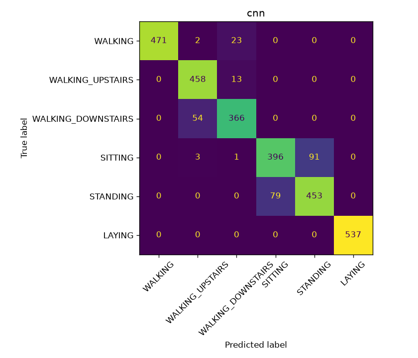

# Activity Recognition

Recognises six activities (walking, walking upstairs, walking downstairs, sitting, standing, lying) from a waist-worn phone's accelerometer and gyroscope. Trained on [UCI HAR](https://archive.ics.uci.edu/dataset/240/human+activity+recognition+using+smartphones), to be fine-tuned on our own recordings.

## Setup

Python 3.10–3.12 (TensorFlow does not support 3.14 yet).

```
pip install -r requirements.txt
streamlit run app/streamlit_app.py
```

Data lives in Google Drive (`HAR-data/`); put it in `data/` (gitignored). Model files go to Drive too, never the repo.

## Results

UCI HAR split by person: 21 people to train (3 of them held out for validation), 9 never-seen people to test.

| Model | Accuracy | Macro F1 |
|---|---|---|
| Random Forest, 561 features | 92.9% | 0.927 |
| 1D-CNN, raw signals | 92.6% | 0.926 |

All runs: [reports/results.md](reports/results.md).

**No overfitting:** early stopping kept the CNN's best epoch (4 of 9); train and validation curves stay close.


**Confusion matrices** (UCI test set). Sitting vs standing is the hardest pair for both models.

| Random Forest | 1D-CNN |
|---|---|
|  |  |

**The data**


## Team

| Owner | Files |
|---|---|
| Nihal | src/data_loader.py, src/preprocess.py |
| Shravya | src/validation.py, docs/data_collection_protocol.md |
| Yash | src/models.py, train.py, evaluate.py |
| Yashaswini | src/inference.py, app/streamlit_app.py |
| Yyug | docs/HLD.md |
