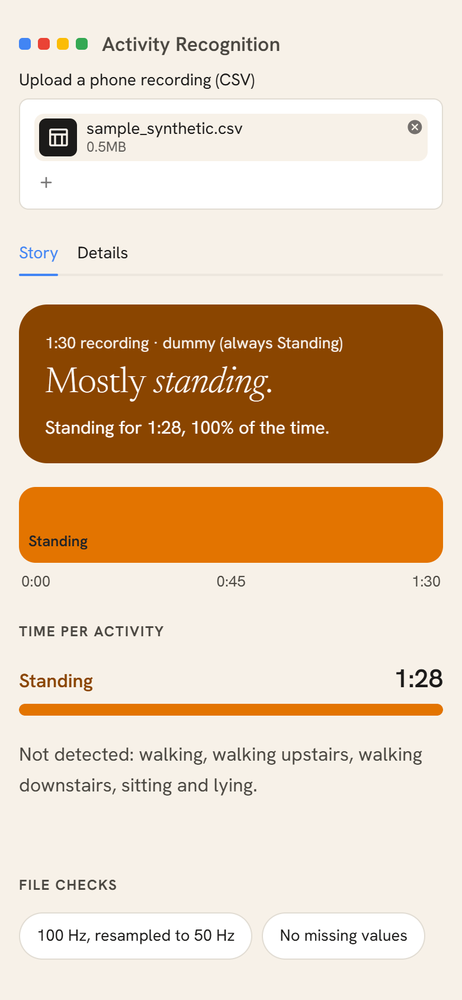
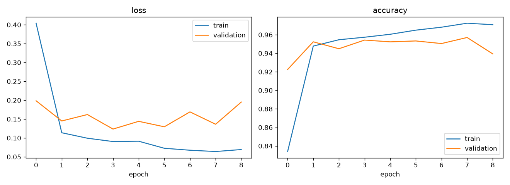
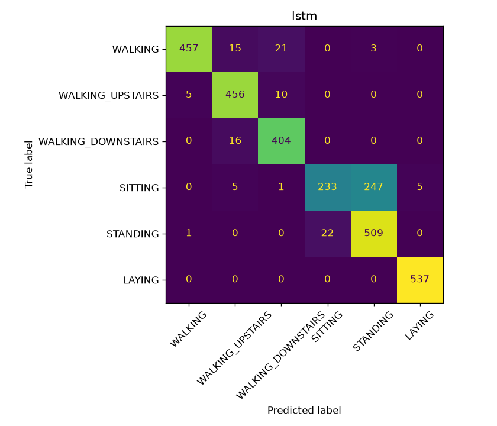
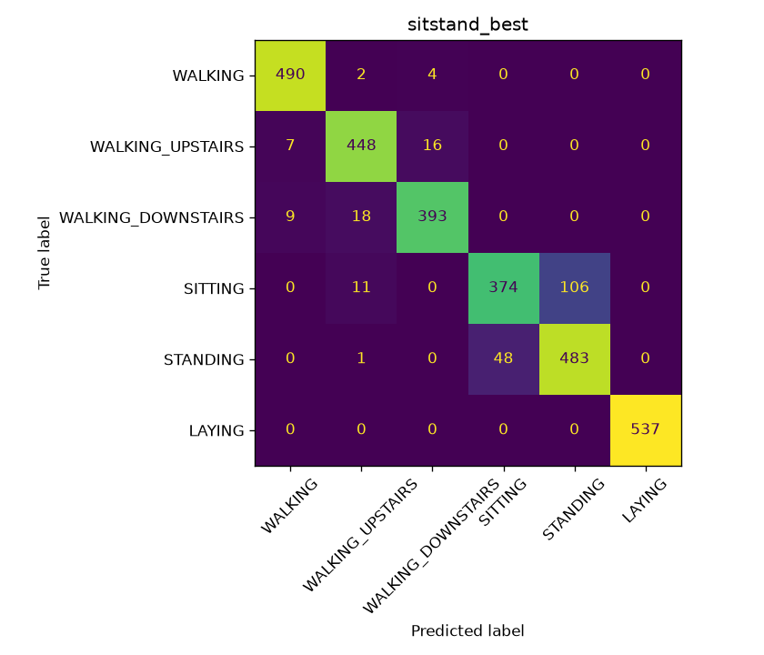
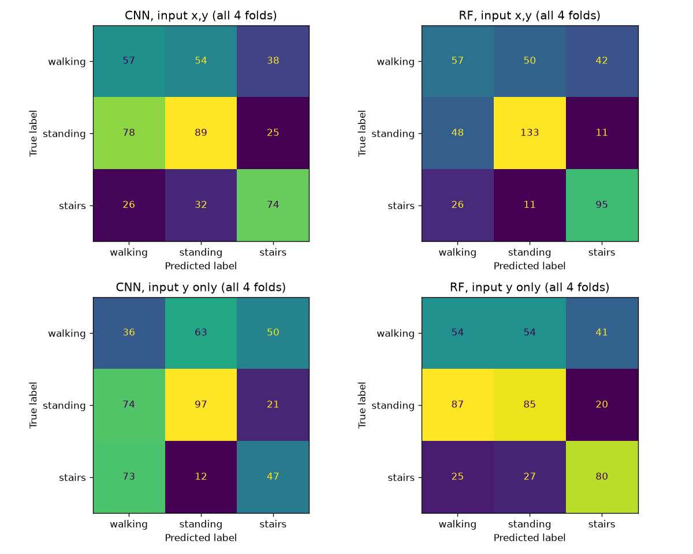
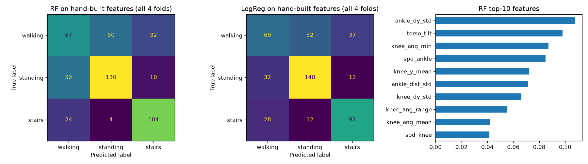

# Activity Recognition

Recognises six activities (walking, walking upstairs, walking downstairs, sitting, standing, lying) from a waist-worn phone's accelerometer and gyroscope. Trained on [UCI HAR](https://archive.ics.uci.edu/dataset/240/human+activity+recognition+using+smartphones). Fine-tuning on our own phone recordings was built (notebook 04) but never run, because the team recorded videos only, with no phone sensor data. That is a limitation of this project; our videos feed a separate camera pipeline instead (see below).

## Setup

Python 3.10–3.12 (TensorFlow does not support 3.14 yet).

```
pip install -r requirements.txt
streamlit run app/streamlit_app.py
```

Data lives in Google Drive (`HAR-data/`); put it in `data/` (gitignored). Model files go to Drive too, never the repo.

## App

Upload a phone recording (CSV) and get a timeline of what you were doing. The app uses the trained 1D-CNN from `models/cnn_uci.keras` (download it from Drive); without it, a dummy model that always says Standing keeps the app runnable.

**Smoothing** (sidebar toggle, on by default): a majority vote over 5 windows (`smooth_window` in `config.yaml`) removes one-window flickers such as walk, sit, walk.




**Live page:** classifies a phone's sensors as they stream over Wi-Fi from the Phyphox app, updating once a second. A replay mode plays `data/sample_synthetic.csv` in real time for demos without a phone. Setup: [docs/live_demo.md](docs/live_demo.md). The phone path is not yet tested on a real phone.

## Results

UCI HAR split by person: 21 people to train (3 of them held out for validation), 9 never-seen people to test.

| Model | Accuracy | Macro F1 |
|---|---|---|
| Random Forest, 561 features | 92.9% | 0.927 |
| 1D-CNN, raw signals | 91.0% | 0.909 |
| LSTM, raw signals (comparison) | 88.1% | 0.875 |

All runs: [reports/results.md](reports/results.md).

**Overfitting is caught by early stopping:** validation loss bottoms out at epoch 2, then drifts up while training loss keeps falling, so training stops at epoch 7 and keeps the epoch-2 weights.

**Run-to-run spread:** the CNN moves about ±0.4 points between training runs (91.3% ± 0.4 over 3 seeds in notebook 05; an earlier run reached 92.6%). The table shows the retrained model the app now uses.



**LSTM comparison:** same split and early stopping as the CNN (best epoch 5 of 10). It trails the CNN by 3 points, mostly on sitting (F1 0.62) and standing (0.79), so the CNN stays the main model.

**Confusion matrices** (UCI test set). Sitting vs standing is the hardest pair for every model.

| Random Forest | 1D-CNN | LSTM |
|---|---|---|
|  |  |  |

**Sitting vs standing** (`notebooks/05_sit_stand.ipynb`): giving the CNN the phone's tilt explicitly (the angle between gravity and each phone axis, as extra channels or as a separate input) does not reduce the mix-ups. About 160 of the 1,023 sitting/standing test windows stay confused either way (mean of 3 seeds). A waist phone tilts by only a few degrees between the two postures, the two angle distributions overlap, and the raw total-acceleration channels already carry that tilt. Merging the two into one "stationary" class raises accuracy from about 91% to about 97%.

| Variant (mean of 3 seeds) | Accuracy, 6 classes | Accuracy, 5 classes (sit + stand merged) | Sit/stand mix-ups |
|---|---|---|---|
| 1D-CNN | 91.3% | 96.8% | 162 |
| + tilt angles as extra channels | 91.4% | 96.8% | 159 |
| + tilt angles as a separate input | 91.9% | 97.7% | 171 |

The separate-input variant's small gain comes from other classes and is within seed noise.



**The data**


## Runs on a phone

The CNN converts to TFLite with `src/export.py`: **410 KB** with 8-bit weights (4x smaller than float32's 1.6 MB), **same accuracy** (91.0-91.1%), and about 0.05-0.14 ms per 2.56 s window on a PC CPU, so a phone has a huge margin. Full int8 is fastest (0.045 ms). Details: [reports/results.md](reports/results.md). `.tflite` files are not in git (build them with `notebooks/06_tflite.ipynb`).

## Camera pipeline (experimental)

Our own recordings are phone **videos** of 5 people (p1-p5) walking, standing and using stairs, with no sensor data, so they cannot train the phone model. Instead a second pipeline reads the video: `src/video_pose.py` extracts 33 body landmarks per frame with MediaPipe Pose, normalises them (centred on the hips, scaled by torso length), cuts 2 s windows, and a model classifies each window. Videos are not in git (`*.mp4` is ignored); keypoints and labels live in `data/video/`.

Classes: **walking, standing, stairs** (up and down merged, because the direction cannot be told from side views). No sitting or lying clips exist, so these scores **cannot be compared** with the phone model's 6-class numbers. 493 windows in total; 1 clip left out (a crouch/jump). p5 has a single walking clip, so p5 is used for training only and never as the held-out person.

Evaluation is leave-one-person-out over p1-p4 (test on one, train on the other four, 4 times). Two baselines: random guessing scores about 0.33 macro F1; always answering "standing" (the largest class) scores 0.39 accuracy but only 0.18 macro F1. Accuracy alone flatters weak models here, so macro F1 is the main number.

| Model | Accuracy | Macro F1 |
|---|---|---|
| 1D-CNN, raw keypoints (`07_video.ipynb`) | 0.46 ± 0.15 | 0.41 ± 0.07 |
| Random Forest, raw keypoints | 0.59 ± 0.16 | 0.59 ± 0.15 |
| Random Forest, 23 hand-built features (`08_video_features.ipynb`) | 0.62 ± 0.15 | 0.63 ± 0.11 |
| Logistic regression, same features | 0.62 ± 0.17 | 0.61 ± 0.15 |

**Read this as a first result, not a finished model.** The CNN overfits (training accuracy 90%, validation about 65%) because 5 people filmed from different angles and places is too little data to learn from. Hand-built features (leg-swing speed and regularity, knee angle) match the raw Random Forest but vary less between people. Dropping single features moves the score by up to 0.04, which is more than any real effect we can measure here, so the features cannot be tuned yet. More people, and the same camera angle for everyone, would help most. Per-person scores range from 0.51 (p2) to 0.76 (p1).

**Caveats.**
- **0.63 is slightly optimistic.** The 23 features, the Random Forest and logistic-regression settings, and the choice of CNN input were all chosen while looking at the same 4 test people. With no separate test set, there was no way to avoid this.
- **The app's model has no held-out score of its own.** It is trained on all 5 people, so 0.63 is the leave-one-person-out estimate for the same recipe, not a test of that exact model.
- **Don't quote the saved CNN's validation accuracy.** `models/video_cnn.keras` (notebook 07, not used by the app) was early-stopped on a random 15% of windows. Windows overlap by 50%, so that validation set shares frames with training, and its 0.87 validation accuracy is inflated.

**Video page** (`app/pages/2_Video.py`): upload a phone video of one person and get a walking / standing / stairs timeline next to the video. It uses the Random Forest on hand-built features, trained on all 5 people (`models/video_rf.joblib`, made by notebook 08, not in git). The page also needs the MediaPipe pose model at `models/pose_landmarker_full.task` ([download](https://storage.googleapis.com/mediapipe-models/pose_landmarker/pose_landmarker_full/float16/latest/pose_landmarker_full.task)). Processing takes about as long as the video.




## Team

| Owner | Files |
|---|---|
| Nihal | src/data_loader.py, src/preprocess.py |
| Shravya | src/validation.py, docs/data_collection_protocol.md |
| Yash | src/models.py, train.py, evaluate.py |
| Yashaswini | src/inference.py, app/streamlit_app.py |
| Yyug | docs/HLD.md |

## Team

| Name | USN |
|---|---|
| Yash Chandra | 1BM25CS318 |