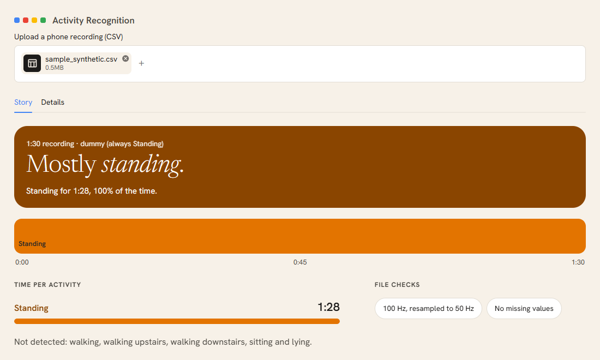
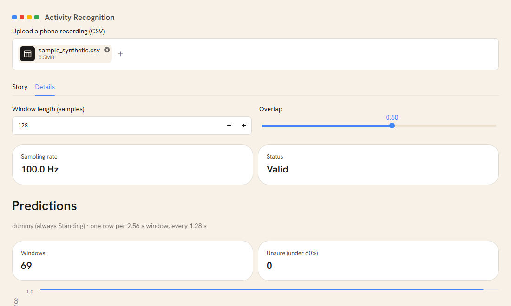
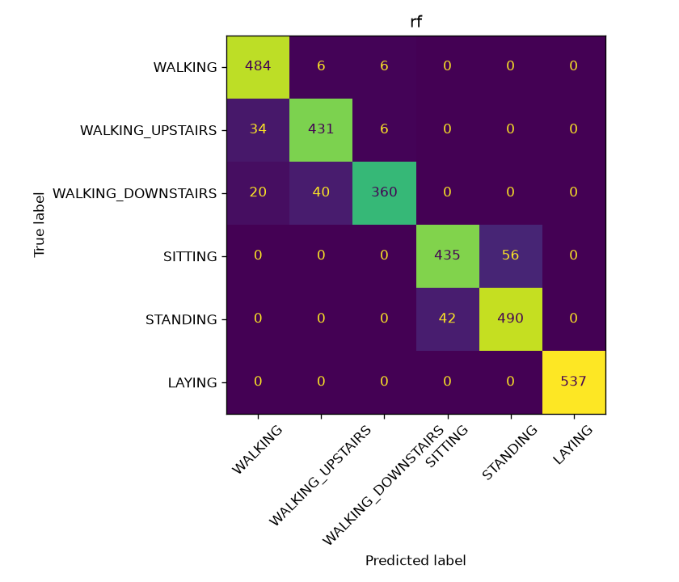
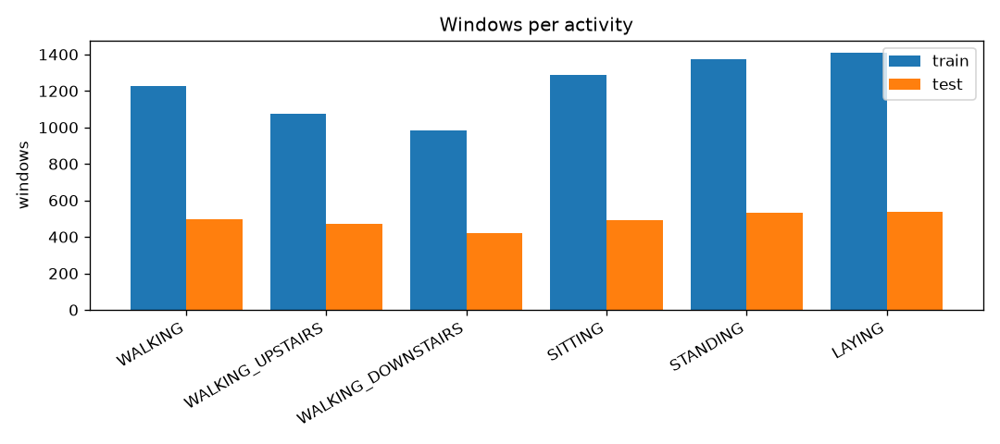
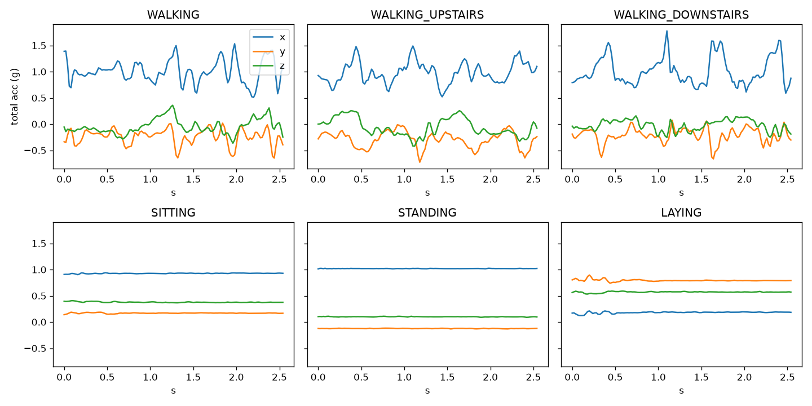

# Activity Recognition

Recognises six activities (walking, walking upstairs, walking downstairs, sitting, standing, lying) from a waist-worn phone's accelerometer and gyroscope. Trained on [UCI HAR](https://archive.ics.uci.edu/dataset/240/human+activity+recognition+using+smartphones), to be fine-tuned on our own recordings.

## Setup

Python 3.10–3.12 (TensorFlow does not support 3.14 yet).

```
pip install -r requirements.txt
streamlit run app/streamlit_app.py
```

Data lives in Google Drive (`HAR-data/`); put it in `data/` (gitignored). Model files go to Drive too, never the repo.

## App

Upload a phone recording (CSV) and get a timeline of what you were doing. The app uses the trained 1D-CNN from `models/cnn_uci.keras` (download it from Drive); without it, a dummy model that always says Standing keeps the app runnable.

**Smoothing** (sidebar toggle, on by default): a majority vote over 5 windows (`smooth_window` in `config.yaml`) removes one-window flickers such as walk, sit, walk.





**Live page:** classifies a phone's sensors as they stream over Wi-Fi from the Phyphox app, updating once a second. A replay mode plays `data/sample_synthetic.csv` in real time for demos without a phone. Setup: [docs/live_demo.md](docs/live_demo.md). The phone path is not yet tested on a real phone.

## Results

UCI HAR split by person: 21 people to train (3 of them held out for validation), 9 never-seen people to test.

| Model | Accuracy | Macro F1 |
|---|---|---|
| Random Forest, 561 features | 92.9% | 0.927 |
| 1D-CNN, raw signals | 92.6% | 0.926 |
| LSTM, raw signals (comparison) | 88.1% | 0.875 |

All runs: [reports/results.md](reports/results.md).

**No overfitting:** early stopping kept the CNN's best epoch (4 of 9); train and validation curves stay close.


**LSTM comparison:** same split and early stopping as the CNN (best epoch 5 of 10). It trails the CNN by 4.5 points, mostly on sitting (F1 0.62) and standing (0.79), so the CNN stays the main model.

**Confusion matrices** (UCI test set). Sitting vs standing is the hardest pair for every model.

| Random Forest | 1D-CNN | LSTM |
|---|---|---|
|  |  |  |

**The data**




## Runs on a phone

The CNN converts to TFLite with `src/export.py`: **410 KB** with 8-bit weights (4x smaller than float32's 1.6 MB), **same accuracy** (91.0-91.1%), and about 0.05-0.14 ms per 2.56 s window on a PC CPU, so a phone has a huge margin. Full int8 is fastest (0.045 ms). Details: [reports/results.md](reports/results.md). `.tflite` files are not in git (build them with `notebooks/06_tflite.ipynb`).

## Team

| Owner | Files |
|---|---|
| Nihal | src/data_loader.py, src/preprocess.py |
| Shravya | src/validation.py, docs/data_collection_protocol.md |
| Yash | src/models.py, train.py, evaluate.py |
| Yashaswini | src/inference.py, app/streamlit_app.py |
| Yyug | docs/HLD.md |
