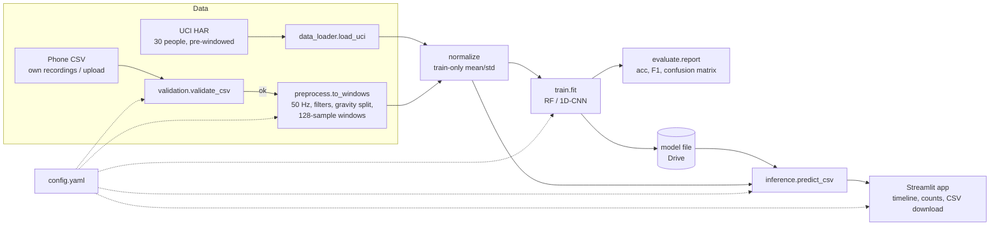

# High-Level Design: Activity Recognition System

IBM Skill Lab · Review 2 · 28 Nov 2026
Team: Yyug (lead), Nihal, Shravya, Yash, Yashaswini (names and USNs on the title page of the PDF)

## 1. Problem and objectives
**Problem.** Every smartphone carries an accelerometer and a gyroscope, but turning their raw signals into "what is this person doing right now" is hard. The same activity looks different from person to person, phone to phone and recording to recording. A model that scores well on the people it was trained on often drops sharply on someone new. Public datasets such as UCI HAR solve the labelling problem but were recorded on one phone model in one lab, so a model trained only on them may not carry over to our own phones.

**Objectives.**

1. Recognise six activities (walking, walking upstairs, walking downstairs, sitting, standing, lying) from a waist-worn phone's accelerometer and gyroscope.
2. Reach **90%+ accuracy** on people the model never saw, with every split made by person: UCI HAR 21 train / 9 test subjects, our own data p1–p3 train / p4–p5 test.
3. Report macro F1, F1 per activity and a confusion matrix, not accuracy alone, so a weak activity cannot hide behind a strong average.
4. Show the model is not overfitting with train vs validation loss and accuracy curves, validated on held-out training subjects.
5. Learn on UCI HAR first, then fine-tune on our own recordings, collected with the same placement, sensors and sampling rate as UCI.
6. Deliver a CSV-upload app that validates a recording (sampling rate, missing readings) before predicting, and shows an activity timeline.

**Success measure.** Accuracy ≥ 0.90 and macro F1 reported on the UCI test subjects (Review 2) and on our own test people p4–p5 (Review 3).

## 2. Scope
- In: phone worn at the waist, recordings exported as CSV and uploaded to a web app.
- Out (for now): live streaming from the phone, other placements, other activities.

## 3. System architecture

UCI HAR is already windowed, so it goes straight to training. Our recordings and every uploaded CSV pass validation and preprocessing first, so the model always gets the same 9-channel, 128-sample windows.

## 4. Components
<!-- Each owner replaces their draft paragraph (150 words max) by Thu night. -->
- **Upload interface (Yashaswini):** Streamlit page with a CSV uploader and a sidebar for window length and overlap, defaulting to `config.yaml`.
- **Validation (Shravya):** `validate_csv` checks required columns, estimates the sampling rate from the median time gap, counts NaNs and gaps over 0.1 s, rejects gaps over 1 s, recordings shorter than 2.56 s and out-of-range values (unit mistakes). Returns `{ok, est_hz, issues, warnings}`.
- **Preprocessing (Nihal):** `to_windows` resamples to exactly 50 Hz, applies a median filter and a 20 Hz Butterworth low-pass, separates gravity with a 0.3 Hz low-pass, builds the UCI channel order (body acc, gyro, total acc) and cuts 128-sample windows with 50% overlap. Channels are normalised with training-only statistics saved in `config/norm_stats.npz`.
- **Models (Yash):** Random Forest (300 trees) on the 561 UCI features as a baseline; 1D-CNN (2 conv layers, dropout 0.5, dense 100) on raw windows.
- **Training and evaluation (Yash):** validation on 3 held-out training subjects, early stopping on validation loss; reports accuracy, macro F1, F1 per activity, confusion matrix and learning curves.
- **Inference (Yashaswini):** `predict_csv` returns one row per window: start time, activity, confidence.
- **App (Yashaswini):** shows the validation report, an activity timeline, counts per activity and a predictions CSV download.

## 5. Data design
| Dataset | People | Split | Format | Storage |
|---|---|---|---|---|
| UCI HAR | 30 | 21 train (3 of them validation: 3, 22, 25) / 9 test, by person | 9 inertial signal files + 561 features | Drive `HAR-data/uci/` |
| Own recordings | 5 (p1–p5) | p1–p3 train / p4–p5 test | CSV `timestamp, acc_x..z (g), gyro_x..z (rad/s)`, file `p1_walking_01.csv` | Drive `HAR-data/own/raw/`, `own/processed/` |

## 6. Model design
1. Random Forest baseline on UCI features.
2. 1D-CNN on raw UCI windows (LSTM as a comparison).
3. Pre-train on UCI, then fine-tune on our data: freeze all but the last two layers, Adam(1e-4), train on p1–p3, test on p4–p5. Compare: UCI model unchanged, fine-tuned, and trained only on our data.

## 7. Data flow
CSV upload → validate → resample to 50 Hz → filter → gravity split → 128-sample windows → normalise → model → activity per window → timeline in the app.

## 8. Technology stack
Python, NumPy, pandas, SciPy, scikit-learn, Keras (TensorFlow), Streamlit, GitHub, Google Drive, Colab.

## 9. Non-functional requirements
- Accuracy: 90%+ on unseen people.
- Repeatable: fixed seeds, one `config.yaml` for every parameter.
- Privacy: subjects are p1–p5 only, never names.

## 10. Risks and mitigation
| Risk | Fallback |
|---|---|
| Our recordings are late or messy | Show the protocol and one validated file; fine-tuning moves to Review 3 |
| CNN stays under 90% | Lead with the Random Forest result; tune the CNN after the review |
| Phone axes or units don't match UCI | Convert to g, compare the gravity axis while standing, swap axes |
| Colab resets and work is lost | Save models, plots and logs to Drive after every run |
| Someone can't push to GitHub | Send files to Yyug to commit |

## 11. Progress and plan to Review 3
- Done: repo and contracts, UCI loader and EDA, preprocessing, validation, RF baseline, first CNN with learning curves, app skeleton.
- Next: record all 5 people, fine-tune on our data, 90%+ on p4–p5, final report.
