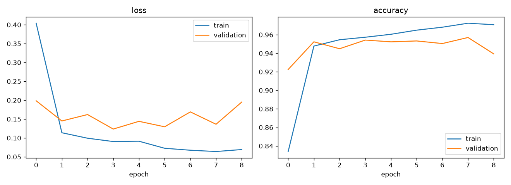

# Models and training

Owner: Yash. Every number below comes from `reports/results.md` and the notebooks it names. Nothing here is rounded up.

## 1. What was built

| Model | Input | Data | Where |
|---|---|---|---|
| Random Forest (300 trees) | 561 ready-made UCI features | UCI HAR | `notebooks/02_baseline_rf.ipynb` |
| 1D-CNN (main phone model) | raw 9-channel windows, 128 samples at 50 Hz | UCI HAR | `notebooks/03_deep_models.ipynb`, `models/cnn_uci.keras` |
| LSTM (comparison) | same windows | UCI HAR | `notebooks/03_deep_models.ipynb` |
| Random Forest on hand-built pose features (camera) | 23 features per 2 s window | our own videos | `notebooks/08_video_features.ipynb` |

The CNN, LSTM and camera models are Keras or scikit-learn only. Training code is in `src/models.py`, `src/train.py` and `src/evaluate.py`. All seeds and window settings come from `config/config.yaml`.

## 2. Phone model on UCI HAR

**Split.** By person, never by random window: 21 people to train (3 of them, subjects 3, 22 and 25, held out for validation) and 9 never-seen people to test. The test set is used once, at the end.

| Model | Accuracy | Macro F1 |
|---|---|---|
| Random Forest, 561 features | 92.9% | 0.927 |
| 1D-CNN, raw signals (the model the app uses) | 91.0% | 0.909 |
| LSTM, raw signals | 88.1% | 0.875 |

The Random Forest and the CNN clear the 90% target. The LSTM does not: it trails the CNN by 3 points, mostly on sitting (F1 0.62) and standing (0.79). The CNN stays the main model because it works on raw windows, which is all a phone recording gives us. The Random Forest needs the 561 UCI features, which cannot be computed from our own recordings.

**Run-to-run spread.** Training is not bit-reproducible. The CNN moves about 0.4 points between runs (91.3% ± 0.4 over 3 seeds, notebook 05). An earlier run reached 92.6%, so a gap of one or two points between CNN and Random Forest is within noise.

### Learning curves

Training loss keeps falling, but validation loss bottoms out at epoch 2 and then drifts up. This is the start of overfitting, and early stopping (patience 5, `restore_best_weights`) catches it: training stops at epoch 7 and keeps the epoch-2 weights. The reported 91.0% is therefore the best-validation model, scored once on the 9 test people.

### Where the errors are

Sitting vs standing is the hardest pair for every model (confusion matrices: `reports/figures/rf_confusion.png`, `cnn_confusion.png`, `lstm_confusion.png`).

## 3. Sitting vs standing (notebook 05)

We tested whether giving the CNN the phone's tilt explicitly would separate the two. Gravity angles (the angle between gravity and each phone axis) were added as extra channels, or as a separate input branch.

| Variant (mean of 3 seeds) | Accuracy, 6 classes | Accuracy, 5 classes (sit + stand merged) | Sit/stand mix-ups (of 1,023 windows) |
|---|---|---|---|
| 1D-CNN | 91.3% | 96.8% | 162 |
| + tilt angles as extra channels | 91.4% | 96.8% | 159 |
| + tilt angles as a separate input | 91.9% | 97.7% | 171 |

**Finding.** No variant reduces the sit/stand mix-ups. A waist-worn phone tilts by only a few degrees between sitting and standing, the two angle distributions overlap heavily, and the raw `total_acc` channels already carry that tilt. The small 6-class gain of the separate-input variant comes from other classes and is within seed noise. Merging sitting and standing into one "stationary" class raises accuracy from about 91% to about 97%, which shows that almost all remaining error is this one pair.

## 4. Running on a phone (TFLite, notebook 06)

| Model | Size (KB) | Accuracy | Macro F1 | ms per window |
|---|---|---|---|---|
| Keras (reference, includes optimizer state) | 4820 | 0.910 | 0.909 | not measured |
| TFLite float32 | 1601 | 0.910 | 0.909 | 0.141 |
| TFLite dynamic-range (8-bit weights) | 410 | 0.910 | 0.909 | 0.051 |
| TFLite full int8 | 411 | 0.911 | 0.910 | 0.045 |

Quantisation costs no accuracy and makes the model about 4x smaller than float32. Latency was measured per window (batch 1, one thread) on a Windows PC CPU, not on a phone, so it shows the margin and not the phone's real speed. The `.tflite` files are not in git; `notebooks/06_tflite.ipynb` builds them.

## 5. Camera models (our own videos)

Our own recordings are phone **videos** of 5 people with no sensor data. A separate pipeline extracts 33 body landmarks per frame with MediaPipe, normalises them (centred on the hips, scaled by torso length), cuts 2 s windows and classifies each window as walking, standing or stairs. There are 493 windows (walking 169, standing 192, stairs 132). No sitting or lying clips exist, and up and down stairs are merged because the direction cannot be told from side views.

**Evaluation.** Leave-one-person-out over p1 to p4: train on the other four people, test on the held-out one, four times. p5 has a single walking clip, so p5 is training-only. The ± is the standard deviation across the 4 held-out people.

| Model | Input | Accuracy | Macro F1 |
|---|---|---|---|
| 1D-CNN | raw keypoints x,y (mirror augmentation) | 0.456 ± 0.150 | 0.407 ± 0.071 |
| 1D-CNN | keypoint height (y) only | 0.373 ± 0.094 | 0.340 ± 0.104 |
| Random Forest | raw keypoints | 0.586 ± 0.159 | 0.589 ± 0.151 |
| Random Forest | keypoint height (y) only | 0.459 ± 0.051 | 0.472 ± 0.085 |
| **Random Forest (used in the app)** | **23 hand-built features** | **0.621 ± 0.150** | **0.627 ± 0.112** |
| Logistic regression | same 23 features | 0.615 ± 0.170 | 0.609 ± 0.150 |

**How to read this.**
- These are 3-class results and cannot be compared with the 6-class phone results.
- Random guessing gives a macro F1 of about 0.33. Always predicting the most common class (standing) gives an accuracy of 0.39 (192 of 493 windows) but a macro F1 of only 0.18, so the raw-keypoint CNN's 0.456 accuracy is only slightly above that, and macro F1 is the number to trust.
- Scores differ a lot between people. For the chosen Random Forest, macro F1 is 0.76 on p1, 0.51 on p2, 0.56 on p3 and 0.68 on p4.
- The CNN overfits: training accuracy reaches about 90% while validation accuracy on the held-out person is far lower and swings between folds. Five people filmed from different angles and places is too little data for a neural network.
- The hand-built features (leg-swing speed and regularity, knee angle) match the raw Random Forest but vary less between people. Dropping single features moves the score by up to 0.04, which is more than any real effect we can measure with 4 test people, so the features cannot be tuned yet.
- The app's Video page uses a Random Forest trained on all 5 people. It has no held-out score of its own. The 0.63 above is the leave-one-person-out estimate for the same recipe.

**Stairs direction.** A second Random Forest splits stairs into up and down (notebook `09_stairs_direction.py`). On a held-out person it picks the right direction 85% of the time (80% on side views, where facing the camera cannot give it away), against 50% with shuffled labels.

**Better use of the body points (notebook `10_body_points.py`).** Undistorted points, a 3D body frame from MediaPipe's depth estimate, and whole-body movement raise the honest (nested) score to accuracy 0.64 ± 0.10 and macro F1 0.65, from 0.62 / 0.63. The app uses this model. Labels were set by eye from the video frames. Details and caveats: `reports/results.md`.

**What would help most:** more people, and the same camera angle for everyone.

## 6. Limitation: fine-tuning on our own data was not possible

The plan was to pre-train the CNN on UCI, then fine-tune it on our own phone recordings (freeze all but the last two layers, Adam 1e-4, train on p1 to p3, test on p4 and p5) and compare three models: UCI only, fine-tuned, and own-data only.

**This was not done, and it could not be.** Our own recordings turned out to be videos. They contain no accelerometer or gyroscope readings, so there is nothing to fine-tune a sensor model on, and there is no phone result for p4 and p5. The fine-tuning code is written (`train.fine_tune`, `data_loader.load_own`, `notebooks/04_fine_tune.ipynb`) and the file loader has a unit test on synthetic files, but the notebook has never been run on real data. For the same reason we make no claim about how the UCI-trained CNN performs on our own phones. UCI HAR was recorded with a specific phone placement, sampling rate and axis convention, and a different phone may shift the accuracy.

To close this limitation, record 5 people with a sensor-logging app (for example Phyphox or Sensor Logger) following `docs/data_collection_protocol.md`, convert to the UCI units, and run notebook 04.

## 7. How to read the numbers (evaluation notes)

- **No person appears in two sets.** Phone: official UCI person-wise split plus 3 held-out validation people. Camera: leave-one-person-out. Windows overlap by 50%, so a random window split would leak near-copies between train and test and was never used for a reported score.
- **Early stopping uses validation only.** The test people are scored once. In the camera cross-validation, early stopping uses a different held-out person, never the test person.
- **Selection used the test people.** The 23 pose features, the Random Forest and logistic-regression settings, and the choice of camera-CNN input were made while looking at the same 4 people. The camera scores are therefore slightly optimistic, and a fresh set of people would be the fair test.
- **The saved camera CNN** (`models/video_cnn.keras`) was early-stopped on a random 15% of windows, which share frames with training windows. Its validation accuracy must not be quoted. The app does not use this model.
